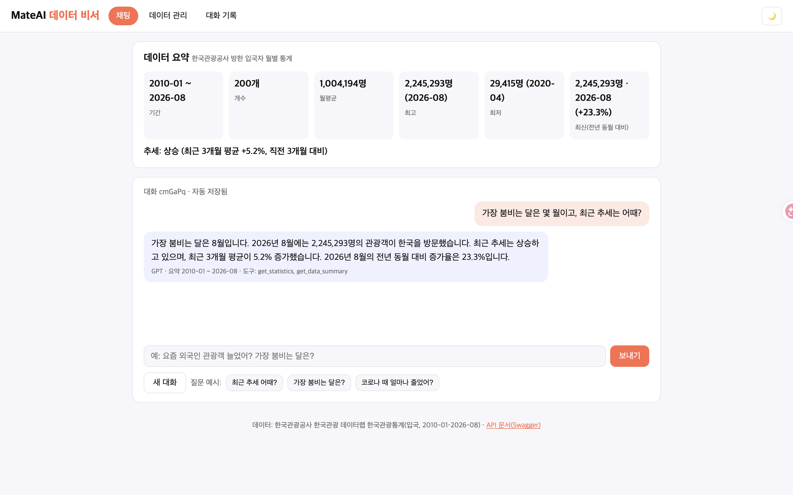
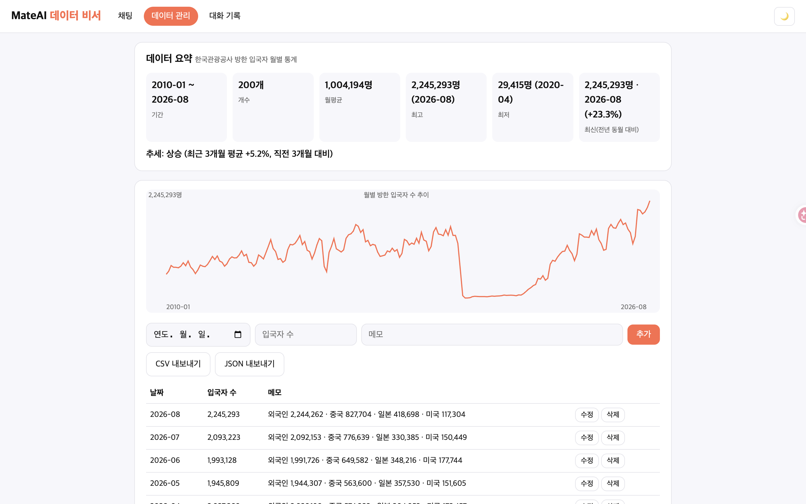
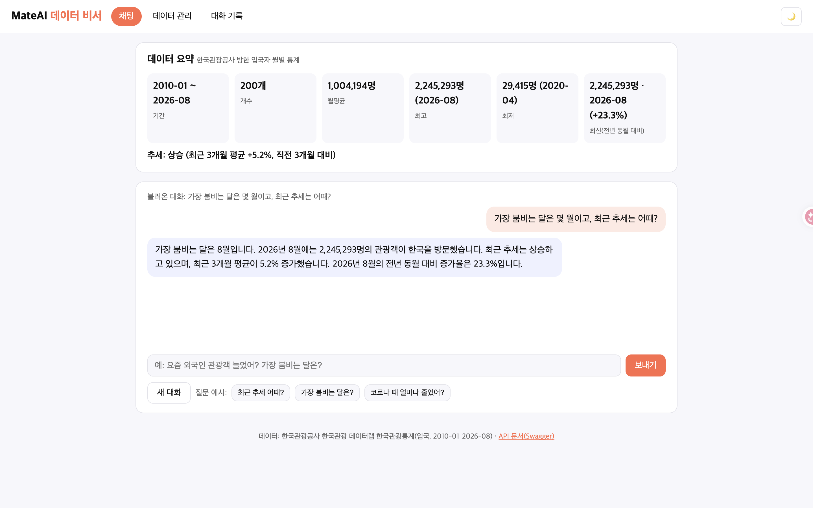

# MateAI 데이터 비서 · 방한 관광 통계를 아는 AI 여행 호스트

> Codyssey 미션 **「AI Agent 개발: 나만의 AI 비서 구축」** 제출 저장소 · 개발자 miru(김호연)
> 기존 프로젝트 MateAI(처음 한국을 찾는 여행자의 AI 현지 호스트, https://mateai-web-jk4v-two.vercel.app/ )에 **"내 데이터를 아는 AI 비서"** 기능을 더한 것이다.

## 1. 서비스 소개: 무엇을 해결하나

일반 챗봇에 "요즘 외국인 관광객 늘었어? 몇 월이 제일 붐벼?"라고 물으면 일반론만 돌아온다.
이 서비스는 **한국관광공사 방한 입국자 월별 통계(2010-01–2026-08, 200개)** 를 Firestore에 저장하고,
그 요약(기간·개수·평균/최대/최소·최근 추세·전년 동월 대비)을 **GPT 시스템 프롬프트에 주입**해
여행 호스트 '민우'가 **실제 숫자를 근거로** 답하게 한다. 더 필요한 값(계절성, 연도별 합계, 최근 원자료)은 GPT가 **도구(Function Calling)** 로 직접 불러온다.

| 입장 경로 | 주소 |
|---|---|
| 솔루션 메이트 플랫폼(입장) | https://trymateai.com/ |
| MateAI 여행 데모 | https://mateai-web-jk4v-two.vercel.app/ |
| 이 과제 프론트(Vercel) | https://mateai-data-assistant.vercel.app/ |
| 백엔드 API(Vercel, Render 대체: 10-1절) | https://mateai-data-assistant-api.vercel.app |
| Swagger UI | https://mateai-data-assistant-api.vercel.app/docs |

## 2. 데이터

| 항목 | 내용 |
|---|---|
| 파일 | `data/inbound_visitors_monthly.csv` (date, value, memo) · **200행** |
| 값 | 월별 방한 입국자 총계(G.TOTAL, 외국인+교포, 명) |
| memo | 그달 외국인·중국·일본·미국 입국자 수 |
| 원천 | 한국관광공사 한국관광 데이터랩 「한국관광통계」 공식 XLSX(입국 시트), 2026-10-24 내려받음 · https://datalab.visitkorea.or.kr/ |
| 교차 확인 | 2010-01 중국 91,252명이 다른 공개 변환본과 일치 |
| 요약 예 | 기간 2010-01 ~ 2026-08 · 200개 · 월평균 1,004,194명 · 최고 2026-08 2,245,293명 · 최저 2020-04 29,415명(코로나) · 최근 3개월 평균 +5.2% 상승 · 전년 동월 대비 +23.3% |

MateAI 엔진이 이미 쓰는 공공 API(한국관광공사 TourAPI `apis.data.go.kr/B551011/KorService2`, 서울 열린데이터광장)는 관광지 정보용이라 시계열이 없어, 이 과제는 데이터랩 공식 통계를 썼다.

## 3. 기술 스택

- Backend: Python 3.10+, **FastAPI**, Uvicorn, **Pydantic v2**, firebase-admin, openai, python-dotenv → **Render**
- DB: Firebase **Firestore** (`data`, `conversations`)
- AI: OpenAI Chat Completions + **Function Calling** (`max_tokens` 400, 도구 호출 최대 3회)
- Frontend: **바닐라 HTML/CSS/JavaScript**(프레임워크 없음) → **Vercel**

## 3-1. 과제가 요구한 도구는 무엇이고, 이 프로젝트에서 무슨 일을 하나

| 요구 도구 | 무엇인가 | 이 프로젝트에서 맡은 일 | 현재 상태 (2026-10-24 13:20) |
|---|---|---|---|
| **FastAPI** | 파이썬으로 웹 API 서버를 만드는 프레임워크. 코드에서 Swagger 문서(`/docs`)를 자동으로 만든다. | 데이터 CRUD·요약·대화 기록·채팅 API 전부. 라우터(HTTP)와 서비스(계산·저장·AI)를 나눴다. | 완료. https://mateai-data-assistant-api.vercel.app/docs |
| **Pydantic** | 들어오는 JSON의 형식을 검사하는 파이썬 라이브러리. | 날짜 형식, 입국자 수 0 이상, 메모 500자, 질문 2,000자 제한. 틀리면 422 오류로 막는다. | 완료 (`backend/app/schemas.py`) |
| **Firebase Firestore** | Google의 클라우드 문서형 데이터베이스. 서버를 꺼도 데이터가 남는다. | `data` 컬렉션(관광 통계 200개, CRUD 대상)과 `conversations` 컬렉션(대화 기록 저장·불러오기). | 완료. 프로젝트 `mateai-data-assistant`, DB 서울(asia-northeast3). 배포본 `/health` = `store: firestore` |
| **firebase-admin** | 서버가 Firestore에 접속하는 공식 파이썬 SDK. | `FIREBASE_SERVICE_ACCOUNT_JSON` 환경 변수로 로그인한다(키는 코드에 없음). | 코드 완료 (`services/store.py`) |
| **OpenAI GPT API** | 대화형 AI 모델을 부르는 유료 API. | 시스템 프롬프트에 데이터 요약을 넣어 답하게 하고(컨텍스트 주입), 필요하면 도구 3개를 직접 부르게 한다(Function Calling). | 완료. 배포본 `/health` = `llm: openai`. 실측 질문 "가장 붐비는 달은?"에 `get_statistics`를 호출해 8월이라고 답함 |
| **Render** | 깃허브 저장소를 연결하면 서버를 띄워 주는 클라우드. 무료 등급은 15분 쉬면 잠들어 첫 요청이 늦다. | 과제 규정상 FastAPI 백엔드의 정식 배포처. `render.yaml`에 빌드·실행 명령과 환경 변수 목록을 적었다. | **대체**: 가입 인증 메일이 오지 않아 Vercel로 배포(10-1절). |
| **Vercel** | 정적 웹사이트(HTML/CSS/JS)를 배포하는 클라우드. | 바닐라 프론트 배포. 빌드 때 `API_BASE_URL` 환경 변수로 백엔드 주소를 `config.js`에 쓴다. | 완료. https://mateai-data-assistant.vercel.app/ |
| **python-dotenv** | `.env` 파일의 값을 환경 변수로 읽는 라이브러리. | 로컬 실행 때 키를 코드 밖 `.env`에 둔다(`.gitignore`로 커밋 금지). | 완료 |
| **CORS 설정** | 다른 주소의 웹페이지가 API를 부를 수 있게 허용하는 브라우저 규칙. | `ALLOWED_ORIGINS`에 프론트·MateAI·trymateai 주소만 허용. | 완료 (실측: 프론트 주소에 `access-control-allow-origin` 응답) |

## 3-2. 과제 목표 6가지를 이 코드로 설명하면

1. **시계열 분석 → 요약 → 서비스 활용:** `services/summary.py`가 200개월치를 날짜순으로 정렬해 기간·개수·합계·평균·최대·최소를 내고, 최근 3개월 평균을 직전 3개월과 비교해 ±5%를 넘으면 상승/하락, 아니면 유지로 판정한다. 같은 함수를 `/api/data/summary`, 화면 요약 카드, 채팅 시스템 프롬프트가 함께 쓴다.
2. **라우터/서비스 분리 기준:** 라우터(`routers/`)는 "어떤 주소로 무엇을 받아 어떤 모양으로 돌려주나"만, 서비스(`services/`)는 "계산·저장·AI 호출"만 한다. 그래서 요약 계산은 서버 없이 시험(`tests/test_summary.py`, 5개 통과)할 수 있고, 저장소를 Firestore↔메모리로 바꿔도 라우터는 그대로다.
3. **Pydantic 검증 이유:** 잘못된 값(음수 입국자, `2026-13-01` 같은 날짜, 너무 긴 글)이 DB와 GPT까지 가면 통계가 틀어지고 비용이 든다. 입구에서 422로 막는다.
4. **Firestore CRUD:** `store.add/list/update/delete`가 각각 `collection().document().set/stream/update/delete`를 부른다. 문서 id는 Firestore가 만든다. 비어 있으면 시작할 때 CSV 200개를 한 번 넣는다(`SEED_ON_EMPTY`).
5. **컨텍스트 주입 원리:** GPT는 우리 데이터를 모른다. 그래서 매 질문마다 최신 요약을 시스템 프롬프트(`services/llm.py` SYSTEM_TEMPLATE)에 글자로 넣어 "이 숫자를 근거로 답하라"고 한다. 요약에 없는 것(달별 계절성 등)은 도구 호출로 더 가져온다.
6. **CORS·환경 변수·키 관리 이유:** 키가 코드에 있으면 공개 저장소에서 누구나 가져가 요금을 쓴다. 그래서 키는 배포처의 환경 변수에만 두고, CORS는 우리 프론트 주소만 허용해 남의 사이트가 이 API를 마음대로 부르지 못하게 한다.

## 4. 구조와 분리 기준

```
backend/app/
  main.py               # 앱 초기화, CORS, 시작 시 빈 DB면 CSV 200개 시드
  config.py             # 환경 변수만 읽는다(키 하드코딩 없음)
  schemas.py            # Pydantic: 입력 검증(날짜 형식, value ≥ 0, 길이 제한)
  routers/              # HTTP 입출력만: data.py, conversations.py, chat.py
  services/             # 일하는 코드: summary.py(통계), store.py(Firestore/메모리), llm.py(프롬프트·도구), seed.py
backend/tests/test_summary.py   # 요약 함수 시험(외부 패키지 없이 실행)
frontend/  index.html style.css app.js config.js vercel.json
data/inbound_visitors_monthly.csv
render.yaml             # Render Blueprint
```

- **라우터 / 서비스 분리:** 라우터는 요청을 받고 응답 모양만 정한다. 계산(요약)·저장(Firestore)·AI 호출은 서비스에 둬서, `summary.py`는 서버 없이 시험하고 `/api/data/summary`와 `/api/chat`이 같은 함수를 쓴다.
- **Pydantic:** 잘못된 날짜·음수·너무 긴 메모는 라우터에 닿기 전에 422로 막힌다. 응답도 `DataOut`·`ChatOut` 모델로 모양을 고정한다.
- **저장소:** `FIREBASE_SERVICE_ACCOUNT_JSON`이 있으면 Firestore, 없으면 로컬 시험용 메모리 저장소(`/health`의 `store`로 표시).

## 5. API (Swagger: `/docs`)

| Method | Path | 설명 |
|---|---|---|
| POST | /api/data | 데이터 추가 (date, value, memo) |
| GET | /api/data | 목록 조회 (날짜순) |
| PUT | /api/data/{id} | 수정 (바꿀 필드만) |
| DELETE | /api/data/{id} | 삭제 |
| GET | /api/data/summary | 요약(프롬프트 주입용) |
| GET | /api/data/statistics | (보너스) 연도별 합계·1–12월 평균·가장 붐비는 달·전년 동월 대비 |
| GET | /api/data/export?format=csv 또는 json | (보너스) 내보내기 |
| POST | /api/conversations | 대화 저장 |
| GET | /api/conversations | 목록 (**messages 미포함**, id·title·message_count·시각) |
| GET | /api/conversations/{id} | 특정 대화 전체 messages (**방식 A**) |
| DELETE | /api/conversations/{id} | 삭제 |
| POST | /api/chat | 컨텍스트 주입 대화 + 자동 저장 (`conversation_id`를 주면 이어서) |
| GET | /health | 저장소·AI 모드 확인 |

요약 응답 예:

```json
{"period":"2010-01 ~ 2026-08","count":200,
 "metrics":{"total":200838844,"average":1004194,"max":2245293,"max_date":"2026-08","min":29415,"min_date":"2020-04"},
 "trend":"상승 (최근 3개월 평균 +5.2%, 직전 3개월 대비)",
 "latest":{"date":"2026-08","value":2245293,"yoy_pct":23.3}}
```

## 6. 컨텍스트 주입과 도구 호출 흐름

```
사용자 질문 ─▶ POST /api/chat
   1) build_summary(Firestore data)        ← /api/data/summary 와 같은 함수
   2) 시스템 프롬프트에 요약 삽입           ← services/llm.py SYSTEM_TEMPLATE
   3) GPT 호출 (tools 3개 제공)
        └ 필요하면 tool_call ─▶ 서버가 실행 ─▶ 결과를 다시 GPT에
   4) 답 + 대화 전체를 conversations 에 저장(자동)
   5) 응답: reply, summary, tool_calls(어떤 도구를 불렀는지), conversation_id
```

| 도구 | 언제 부르나(설명에 적은 근거) |
|---|---|
| get_data_summary | 요약을 다시 확인할 때 |
| get_statistics | "몇 월이 붐벼?", "연도별로 보면?"처럼 계절성·연도 합계가 필요할 때 |
| get_recent_data(n) | "최근 6개월 중국인은?"처럼 원자료·국가별 메모가 필요할 때 |

프론트는 먼저 Render 주소의 `/health`를 8초 동안 확인하고, 응답이 없으면 예비 서버(Vercel)로 바꾼다.
프론트 채팅 말풍선 아래에 `도구: get_statistics`처럼 실제 호출한 도구가 표시된다.
`OPENAI_API_KEY`가 없으면 요약 숫자로 만든 규칙 기반 답(`mode: offline`)을 돌려 흐름만 확인할 수 있다.

## 7. 프론트 화면

- **채팅:** 입력, 말풍선, 로딩 표시(점 3개), 질문 예시 버튼, 새 대화
- **데이터 요약 카드(항상 위):** 기간·개수·월평균·최고·최저·최신(전년 동월 대비)·추세
- **데이터 관리:** 추가, 목록, 수정, 삭제, 월별 추이 그래프(canvas), CSV/JSON 내보내기
- **대화 기록:** 목록, 불러오기(채팅 탭에 다시 표시), 삭제
- 다크 모드 토글, Render 콜드스타트 안내("서버를 깨우는 중…", 3초 넘게 걸리면 표시)

## 8. 로컬 실행

```bash
cd backend
python3 -m venv .venv && source .venv/bin/activate
pip install -r requirements.txt
# backend/.env.example 을 복사해 backend/.env 를 만들고 값 채우기
# (값이 없으면 메모리 저장소 + 오프라인 답으로 돈다)
uvicorn app.main:app --reload            # http://127.0.0.1:8000/docs
python -m unittest tests.test_summary    # 요약 시험 5개
# 프론트: 다른 터미널에서
cd ../frontend && python3 -m http.server 5500   # http://localhost:5500 (config.js 기본값 127.0.0.1:8000)
```

## 9. 환경 변수 (최소 세트)

| 이름 | 쓰는 곳 | 설명 |
|---|---|---|
| OPENAI_API_KEY | 백엔드 | GPT 호출 |
| FIREBASE_SERVICE_ACCOUNT_JSON | 백엔드 | 서비스 계정 JSON 전체(한 줄). 또는 `FIREBASE_SERVICE_ACCOUNT_PATH` |
| ALLOWED_ORIGINS | 백엔드 | CORS 허용 도메인(쉼표 구분) |
| OPENAI_MODEL / MAX_TOKENS | 백엔드 | 기본 gpt-4o-mini / 400 |
| SEED_ON_EMPTY | 백엔드 | 1이면 빈 DB에 CSV 200개 자동 입력 |
| API_BASE_URL | 프론트(Vercel) | 백엔드 주소. 빌드 때 `config.js`로 써진다 |

키와 서비스 계정 파일은 `.gitignore`로 막았고 코드에 넣지 않는다.

## 10. 배포

1. **Firebase:** 콘솔 → 프로젝트 만들기 → Firestore Database 만들기 → 프로젝트 설정 › 서비스 계정 › 새 비공개 키(JSON).
2. **Render:** New › Blueprint → 이 저장소 선택(`render.yaml`) → `OPENAI_API_KEY`, `FIREBASE_SERVICE_ACCOUNT_JSON` 입력 → 배포 후 `/docs` 확인.
3. **Vercel:** New Project → 이 저장소, Root Directory `frontend` → 환경 변수 `API_BASE_URL=<Render 주소>` → 배포.
4. Render의 `ALLOWED_ORIGINS`에 Vercel 주소를 더한다.

## 10-1. Render 대신 Vercel로 백엔드를 배포한 이유 (동료평가 참고)

- 과제 규정 배포처는 Render다. 2026-10-24 Render 가입을 Google·GitHub 두 방법으로 시도했지만, 두 번 모두 이메일 인증 화면(https://dashboard.render.com/verify-email)에서 인증 메일이 오지 않아 계정을 쓸 수 없었다.
- 그래서 **같은 FastAPI 코드를 Vercel Python 서버리스로 배포**했다(https://mateai-data-assistant-api.vercel.app/docs). 코드 수정은 진입 파일 `backend/index.py` 한 줄뿐이다.
- Render 배포 설정은 `render.yaml`에 그대로 있어, 인증이 풀리면 New › Blueprint 한 번으로 옮길 수 있다.
- 두 플랫폼의 차이: Render는 상시 서버(무료는 15분 쉬면 잠듦, 첫 요청 30–60초)이고, Vercel은 요청마다 함수가 뜨는 서버리스(첫 요청 몇 초)다. 그래서 대화 기록은 메모리가 아니라 **Firestore에 저장해야** 여러 함수 인스턴스 사이에서 유지된다.

## 11. 제출 스크린샷

| 화면 | 파일 |
|---|---|
| ① 데이터 요약이 보이는 채팅(질문+답변) |  |
| ② 데이터 관리(목록 200개·그래프·추가/수정/삭제) |  |
| ③ 대화 기록 |  |

스크린샷은 2026-10-24 13:52 배포본(GPT + Firestore 모드)이다. ① 답 아래에 실제로 부른 도구(get_statistics, get_data_summary)가 표시된다. ③ 대화 목록에서 '불러오기'를 눌러 저장된 대화를 채팅 탭에 다시 띄운 화면이다.

## 12. 진행 상태 (2026-10-24)

- [x] 데이터 200개(공식 통계) · 요약/통계 함수 · 시험 5개 통과
- [x] FastAPI 데이터 CRUD 4 + summary, 대화 API 4, /api/chat(컨텍스트 주입 + 자동 저장)
- [x] 바닐라 프론트(채팅·요약 카드·데이터 관리·대화 기록)
- [x] 보너스: Function Calling 3개, statistics, 그래프, CSV/JSON 내보내기, 다크 모드
- [x] Firebase 프로젝트 `mateai-data-assistant` + Firestore(asia-northeast3) 생성
- [x] Vercel 프론트·백엔드 배포, 서비스 계정 키·OpenAI 키 입력(Firestore·GPT 모드), 스크린샷
- [ ] Render 배포(가입 인증 메일 미수신, 10-1절)
- [ ] 보너스: MCP Server 또는 GPT Actions 연동
